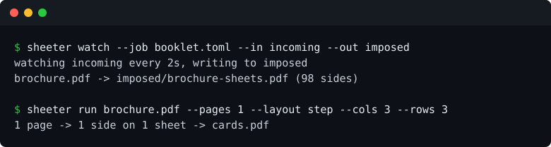

# sheeter

Impose PDF pages onto press-ready sheets. One binary, libc and nothing else, no Acrobat, no Ghostscript.



```
cargo install sheeter
```

## What it does

- **nup** pages in reading order, `--cols` by `--rows`, duplex, mirrored backs for long-edge flipping.
- **booklet** two-up saddle stitch, page order worked out, `--creep` shifts each sheet inward for the fold.
- **step** one block repeated across the sheet, for stacks that get guillotined into identical piles.
- **marks** crop lines at every trim corner, registration targets at the sheet corners.
- **watch** a folder and impose everything that lands in it.
- **report** a CSV of which page went to which sheet, side and tile.

Job files are TOML:

```toml
sheet = "a4l"
layout = "booklet"
duplex = true
margin = "8mm"
gutter = "6mm"
creep = "0.25mm"
marks = ["crop"]
```

Lengths are millimetres unless you write `mm`, `cm`, `in` or `pt`.

## Measured

| | |
|---|---|
| 194 A4 pages into a 98-side saddle-stitch booklet | 0.25 s, 49 MB peak |
| Text carried through that job | 388,948 of 388,948 characters |
| Binary | 2.3 MB, links libc, libm, libgcc |
| Complaints from qpdf and poppler on the output | none |

## How it is checked

`cargo test` reads the output back to prove which source page landed in which tile, so the signature is verified from the file rather than from the code that wrote it. `scripts/check_with_poppler.sh` counts characters with `pdftotext` and requires every page to appear exactly once in the placement report. CI runs both on a 194-page RFC on every push, and again on the first of the month with a lockfile resolved from scratch.

## What it does not do

- No GUI and no preview. It is a batch tool, and the report is the proof.
- No bleed generation. `--bleed` lets existing artwork overhang the trim; it will not make bleed that is not there.
- No numbering, bates stamps or ticket numbers. Those come in the artwork.
- No preflight, no spot colours, no PDF/X.
- It never modifies the source.

## Licence

Apache-2.0. Free to use, and there is no plan to charge for it.
